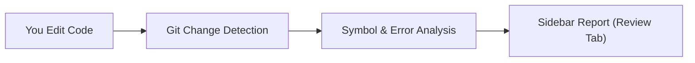

<p align="center">
  
</p>

<h1 align="center">Z-Code-Guard</h1>

<p align="center">
  <strong>Your smart code-review companion for VS Code. Understand your changes, catch new errors, and protect your important files before you commit.</strong>
</p>

<p align="center">
  <a href="https://zeesu-royalist.vercel.app"></a>
  
  
  
</p>

---

## 📌 Table of Contents

- [What is Z-Code-Guard?](#-what-is-z-code-guard)
- [Why Do You Need It?](#-why-do-you-need-it)
- [What Benefits Do You Get?](#-what-benefits-do-you-get)
- [How Does It Work?](#-how-does-it-work)
- [Quick Start & Installation](#-quick-start--installation)
- [Features & Walkthrough](#-features--walkthrough)
- [Optional Configuration](#-optional-configuration)
- [All Commands](#-all-commands)
- [Privacy & Safety](#-privacy--safety)
- [Author & Developer](#-author--developer)
- [License](#-license)

---

## 🛡️ What is Z-Code-Guard?

**Z-Code-Guard** is a free, local VS Code extension that lives in your sidebar like a smart code reviewer.

Whenever you or an AI coding assistant (like GitHub Copilot, ChatGPT, or Claude) edit files in your project, Z-Code-Guard immediately inspects what changed. Instead of just showing a long list of filenames, it clearly tells you:
- Exactly which **functions and classes** were modified.
- If any **new compiler or linter errors** were introduced.
- Which **other files in your project** might be affected.
- If changes touched **sensitive code** (like authentication, payments, or database operations).

Everything runs 100% locally on your computer with zero setup required.

---

## ❓ Why Do You Need It?

When you make changes or accept code from AI tools, regular Git only tells you something basic like:
```text
3 files changed, 45 insertions(+), 12 deletions(-)
```

That leaves you with important unanswered questions:
1. **Did I break any existing functions or interfaces?**
2. **Did this change introduce new errors that weren't there before?**
3. **What other files depend on the code I just modified?**
4. **Did I accidentally touch sensitive configuration or security boundaries?**

Z-Code-Guard answers all these questions directly in your sidebar before you commit or push your code.

---

## 🌟 What Benefits Do You Get?

| Benefit | How Z-Code-Guard Helps You |
| :--- | :--- |
| **⚡ Fast Reviews** | See line changes (`+10 -2`) and touched functions right on each file row. |
| **🐛 Zero Regressions** | Snapshot your current errors with one click, so you instantly see if your new changes added fresh errors. |
| **🛡️ Protected Boundaries** | Set important folders (like `src/auth` or `src/payments`) as protected. If anyone touches them, you get an instant red alert. |
| **🔗 Impact Awareness** | Know which other files import or test the code you changed before you break them. |
| **🔒 100% Private & Free** | Zero cloud servers, zero tracking, zero API keys. Your code never leaves your computer. |

---

## ⚙️ How Does It Work?



1. **Detects Changes:** When you save a file, it asks your local Git for changed files using safe, read-only commands (`git status`, `git diff`).
2. **Parses Code:** It scans modified lines to see exactly which functions, methods, or components overlap with the changes.
3. **Checks Errors:** It compares current VS Code diagnostics against your baseline to highlight new vs. existing errors.
4. **Organizes the View:** It displays clean sections in your sidebar: **Protected Changes**, **Other Changes**, **Risk Findings**, and **Validation Checks**.

---

## 🚀 Quick Start & Installation

### Option 1: Install from VS Code Marketplace
1. Open VS Code.
2. Go to the **Extensions** tab (<kbd>Ctrl+Shift+X</kbd> on Windows/Linux, <kbd>Cmd+Shift+X</kbd> on Mac).
3. Search for **`Z-Code-Guard`**.
4. Click **Install**.

### Option 2: Install from `.vsix` Package
If you have the `z-code-guard-0.2.0.vsix` file:
```bash
code --install-extension z-code-guard-0.2.0.vsix
```
Or open the Extensions tab in VS Code, click the **`...`** menu in the top right, and select **Install from VSIX...**.

---

## 🔍 Features & Walkthrough

### 1. Clean Change Explorer
- Clearly groups files into **PROTECTED CHANGES** and **OTHER CHANGES**.
- Displays exact line changes (`+5 -2`) and Git status (`unstaged`, `staged`, `untracked`).
- Hover over any file to click the **Diff Icon** (`View Diff`) or the **Checkmark Icon** (`Mark as Reviewed`).
- Click any file to open it directly in the editor.

### 2. Function & Symbol Detection
- Expanding a file reveals the exact functions, classes, components, and interfaces that changed.
- Clicking any symbol jumps straight to its line in your code.
- Symbols are clearly marked with color-coded icons (functions, classes, interfaces).

### 3. Diagnostics & Error Comparison
- Takes a snapshot of your project's current errors using **Record Diagnostics Baseline**.
- As you continue coding, new compiler errors are labeled as **`NEW`** in red, while old ones are labeled as **`existing`**.
- Helps you ensure you never introduce new bugs while fixing existing code.

### 4. Impacted Files Finder
- Shows you which other files in your project import or test the modified code.
- Categorizes links as `[verified]` (actual import statements) or `[test]` (test suites).

### 5. Smart Risk Findings
Warns you when changes touch potentially risky patterns:
- **Protected Boundaries:** Changes made inside sensitive directories.
- **Authentication:** Changes affecting tokens, passwords, sessions, or logins.
- **Permissions:** Changes modifying role checks or access-control logic.
- **Payment Operations:** Changes mentioning payment gateways or transactions.
- **Secret Values:** Warns if API keys or environment variables are touched (*secret values are automatically masked for privacy*).
- **Destructive Commands:** Warnings for commands like `DROP TABLE`, `rmSync`, or `eval`.

### 6. One-Click Project Checks
- Automatically finds scripts from your `package.json` (such as `npm run lint`, `npm run test`, `npm run build`).
- Click any check to run it on-demand with a confirmation popup.

---

## ⚙️ Optional Configuration

> [!NOTE]
> **Configuration is 100% optional.** Z-Code-Guard works right out of the box in any Git project without any config file.

If you want to customize which folders are protected, create a `.z-code-guard.json` file in your project root, or run **`Z-Code-Guard: Configure Workspace`** from the Command Palette (<kbd>Ctrl+Shift+P</kbd> / <kbd>Cmd+Shift+P</kbd>).

### Example `.z-code-guard.json`:
```json
{
  "version": 1,
  "protectedPaths": [
    "src/auth/**",
    "src/payments/**",
    "src/core/**"
  ],
  "excludePaths": [
    "node_modules/**",
    "dist/**",
    "coverage/**"
  ]
}
```

- **`protectedPaths`**: Any changes in these folders trigger a red alert in the **PROTECTED CHANGES** section.
- **`excludePaths`**: Folders you want Z-Code-Guard to ignore completely.

---

## ⌨️ All Commands

Press <kbd>Ctrl+Shift+P</kbd> (or <kbd>Cmd+Shift+P</kbd> on Mac) and type `Z-Code-Guard`:

| Command | What It Does |
| :--- | :--- |
| **Scan Workspace** | Refreshes the review tree and re-scans all Git changes. |
| **Record Diagnostics Baseline** | Snapshots current errors so you can easily spot new bugs later. |
| **View Diff** | Opens a side-by-side diff against your last commit. |
| **Configure Workspace** | Interactive setup helper with starter presets for your project. |
| **Open Configuration** | Opens your `.z-code-guard.json` file in the editor. |
| **Mark / Unmark as Reviewed** | Checks off a file so you can track your review progress. |

---

## 🔒 Privacy & Safety Promises

- **100% Local Execution:** Everything runs directly on your computer.
- **Zero Network Calls:** No external requests, no cloud servers, no analytics, no telemetry.
- **Safe & Non-Destructive:** Uses read-only Git commands. It will **never** commit, stage, delete, or alter your source code automatically.
- **Credential Protection:** If environment secrets are touched, their values are automatically redacted so they are never exposed in the UI.

---

## 👤 Author & Developer

**Zeesu Royalist**
- **Website:** [zeesu-royalist.vercel.app](https://zeesu-royalist.vercel.app)
- **GitHub:** [@zeesu-royalist](https://github.com/zeesu-royalist)

---

## 📄 License

This project is open-source and licensed under the [MIT License](LICENSE) — Copyright (c) 2026 [Zeesu Royalist](https://zeesu-royalist.vercel.app).
